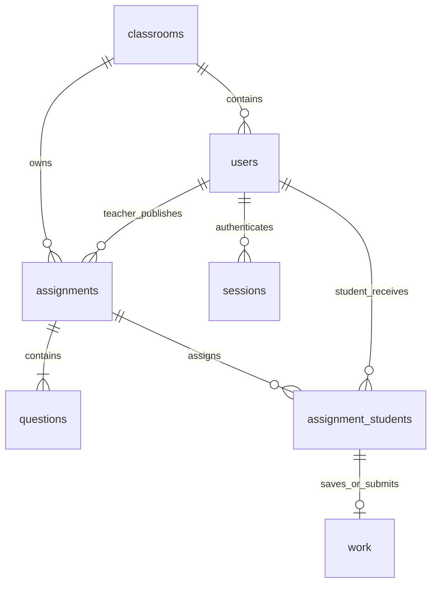

# 架构与维护说明

## 技术与边界

- `client/`：React、TypeScript、React Router 与普通 CSS，Vite 提供开发服务器与生产构建。
- `server/`：Express 单体应用，参数使用 Zod 校验；Node 内置 `node:sqlite` 访问 SQLite。
- `shared/types.ts`：前后端共用业务类型、知识点名称和说明，不含学生不该看见的正确答案。
- 前端不直接连接数据库，自动批改只在后端运行。正常运行不需要 OpenAI API key，也不依赖外部题库。
- 开发时 Vite 把 `/api` 转发到 `3001`；生产时 Express 同时提供构建后的前端和 API，浏览器始终访问同一来源。

采用 SQLite 是为了让一个班级不必先安装、配置独立数据库服务。数据库保存在文件中，可以关闭服务后直接备份；单个后端进程足够本项目的目标规模。尚未做多实例共享存储或大规模并发验证。

## 数据关系



| 表                    | 职责                               | 关键约束                                               |
| --------------------- | ---------------------------------- | ------------------------------------------------------ |
| `settings`            | 是否为演示数据库                   | 初始化标志保存在库中                                   |
| `classrooms`          | 班级                               | 第一版只初始化一个                                     |
| `users`               | 教师、学生与密码哈希               | 账号忽略大小写唯一；角色约束                           |
| `sessions`            | 登录状态                           | 只存随机 token 的 SHA-256，7 天过期                    |
| `assignments`         | 名称、班级、知识点、题量、截止时间 | 题量限 10 / 20 / 50                                    |
| `questions`           | 固定题目与正确答案                 | 每份作业题号唯一                                       |
| `assignment_students` | 发布时的学生名单快照               | 作业与学生组合唯一                                     |
| `work`                | 草稿或已提交答卷                   | 每位学生每份作业一条；有版本号；正式提交与成绩同时存在 |

外键开启；启用 WAL 与 5 秒忙等待。`server/database.ts` 管理建表和初始化。当前 schema 版本为 1；后续若需改变表结构，应增加显式迁移，不能靠删除数据库升级。

## 作业状态

```text
发布并分配学生
  ├─ 没有 work 记录 → 未开始
  └─ 保存 work，submitted_at 为空 → 草稿（不计分）
       └─ 截止前正式提交 → 已提交（分数、答对数和时间同时写入，永久锁定）
```

截止是一个基于时间的限制，不把草稿变成已提交，也不自动计 0 分。已提交人数为 `submitted_at` 非空的记录数；未提交人数为名单总数减已提交数；平均分只统计已提交答卷。

写草稿与提交均校验：学生身份、班级和分配名单、尚未提交、尚未截止、版本号与题目所属。关键读取和写入在同步 SQLite 事务中进行。

## 主要代码

| 文件                        | 内容                                         |
| --------------------------- | -------------------------------------------- |
| `server/math.ts`            | 候选题池、无放回随机出题、数字判分           |
| `server/database.ts`        | SQLite 表、事务、发布名单快照、首次初始化    |
| `server/app.ts`             | HTTP API、权限、输入校验、会话、提交与统计   |
| `server/security.ts`        | 随机盐 scrypt 密码哈希与随机会话 token 哈希  |
| `server/config.ts`          | 环境变量与数据库路径                         |
| `server/index.ts`           | 初始化和启动、静态文件、关闭连接             |
| `client/Teacher.tsx`        | 教师列表、发布、学生管理、统计和逐题答卷     |
| `client/Student.tsx`        | 学生列表、自动保存队列、离开保护、提交和反馈 |
| `client/auth.tsx`           | 当前登录身份与登录 / 退出                    |
| `client/components.tsx`     | 表单弹窗、状态反馈、保存后退出的协调         |
| `client/styles.css`         | 主题、页面布局、桌面与移动尺寸适配           |
| `server/tests/`             | 出题属性测试、API 集成与文件持久化测试       |
| `e2e/`                      | Chromium 端到端测试                          |
| `scripts/restart-smoke.mjs` | 真实后端进程重启检查                         |

## API 概览

所有响应为 JSON，错误统一为 `{ "error": "可读信息" }`。写入请求必须为 `application/json`；浏览器按同源方式访问，未开放通用 CORS。

| 方法       | 路径（省略 `/api`）                            | 权限与用途                              |
| ---------- | ---------------------------------------------- | --------------------------------------- |
| GET        | `/health`、`/config`                           | 健康状态、是否展示演示账号              |
| POST       | `/auth/login`                                  | 密码登录，设置 HttpOnly Cookie          |
| GET        | `/auth/me`                                     | 当前身份和班级                          |
| POST       | `/auth/logout`、`/auth/password`               | 撤销当前会话、修改本人密码              |
| GET / POST | `/teacher/students`                            | 教师查看 / 创建本班学生                 |
| POST       | `/teacher/students/:studentId/password`        | 教师重置密码并撤销该学生所有会话        |
| GET / POST | `/teacher/assignments`                         | 教师列表 / 生成并发布                   |
| GET        | `/teacher/assignments/:id`                     | 本班作业统计、名单、题目                |
| GET        | `/teacher/assignments/:id/students/:studentId` | 逐题查看草稿或答卷                      |
| GET        | `/student/assignments`                         | 本人被分配的作业                        |
| GET        | `/student/assignments/:id`                     | 本人题目与草稿；提交后才含正确答案      |
| PUT        | `/student/assignments/:id/draft`               | 保存 `{ answers, revision }`            |
| POST       | `/student/assignments/:id/submit`              | 提交 `{ answers, revision }` 并自动评分 |

`answers` 是题目 UUID 到答案字符串的映射。前端不得提交得分；API 会拒绝不属于该份作业的题目。版本不符返回 409，不覆盖服务器新草稿。

前端带上其当前页面身份的 `X-Classwork-User`。如果其他标签页切换账号，Cookie 会共享变化，但旧页面内存中的身份不会自动变化；后端校验二者一致，避免把旧页面的答案写到新登录账号。该头只用于一致性保护，真实身份与权限仍由服务器会话决定。

网络响应丢失时，客户端读取服务器现有答卷来核实状态。只有服务器草稿的标准化答案与待保存内容完全一致，才接受服务器版本号；不同内容仍作为版本冲突处理。若服务器已经正式提交，则直接展示已批改结果，避免把成功提交误报成未提交。

保存失败不清空内存答案。可以在新页面登录原账号后返回重试；退出时由专门的确认框让学生选择保留当前页面或丢弃尚未保存的修改。截止后的脏草稿也经过相同退出确认。

## 账户与请求保护

密码使用 scrypt 和随机盐，不保存明文。Cookie 使用 HttpOnly、SameSite=Lax；HTTPS 部署时开启 Secure。会话存入数据库，退出时撤销，过期会话在登录时清理。修改本人密码会撤销其他设备的登录，教师重置学生密码会撤销该学生全部登录。

API 响应不缓存；参数化 SQL、角色和班级检查、请求体大小限制、来源检查与登录失败限流均在服务器执行。默认未信任反向代理的 IP 头，因此不应随意添加 `trust proxy=true`。如未来需要复杂代理部署，需按实际网络拓扑配置可信代理，再调整登录限流。

当前前后端用同源代理和同源 Cookie；如未来分别部署到不同站点，需要一并设计 CORS、Cookie 和 CSRF，不能只改 API 地址。

开发参考：[Vite 文档](https://vite.dev/guide/)、[Express 安全实践](https://expressjs.com/en/advanced/best-practice-security/)、[Node.js SQLite API](https://nodejs.org/docs/latest-v22.x/api/sqlite.html)。
